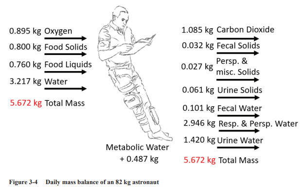
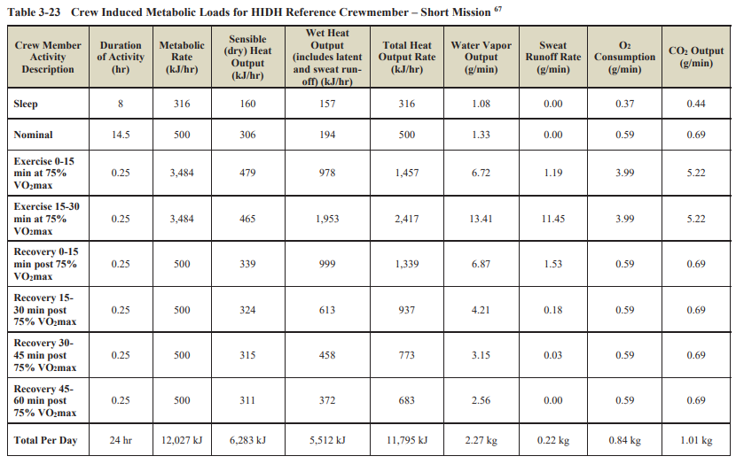
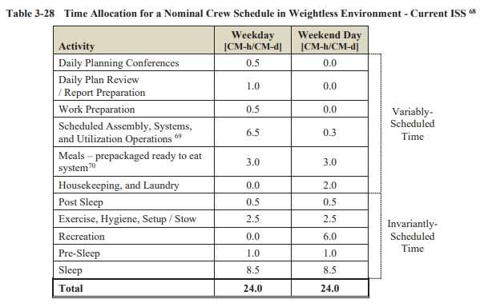

# ECLSS Sizing Tool

Python library for computing Environmental Control and Life Support System (ECLSS) requirements for crewed spacecraft and habitat missions. All reference values trace to NASA/TP-2015-218570/REV2, *Life Support Baseline Values and Assumptions Document* (BVAD).

Define crew members (each with their own schedule and metabolic rates), place them in a habitat with optional ECLSS hardware, and run a simulation to get oxygen demand, CO2 production, thermal loads, water balance, consumables budgets, contaminant accumulation, and PASS/FAIL assessment.

## Architecture

Three core classes:

- **`CrewMember`** — a person with their own schedule and metabolic rates. Activity rates scale from the BVAD 82 kg reference crewmember by BMR ratio. Override any rate with `CrewMetabolicProfile`.
- **`Habitat`** — a place with volume and optional ECLSS hardware (`EclssSystem`). No crew, no mission duration — those belong to the Simulation.
- **`Simulation`** — puts crew in a habitat for a mission duration, produces time-series results.

## Quickstart

```python
from eclss import CrewMember, Habitat, Simulation, EclssSystem, size_mission

# 1. Define crew members (each with their own metabolic rates and schedule)
crew = [
    CrewMember(name="Kirk",   age=34, mass_kg=82, height_m=1.78, sex="male"),
    CrewMember(name="Uhura",  age=29, mass_kg=61, height_m=1.68, sex="female"),
    CrewMember(name="Spock",  age=35, mass_kg=77, height_m=1.91, sex="male"),
    CrewMember(name="Scotty", age=44, mass_kg=85, height_m=1.75, sex="male"),
]

# 2. Define a habitat (unlimited ECLSS by default — sizing mode)
habitat = Habitat(cabin_volume_m3=25.0)

# 3. Run the full mission analysis in one call
result = size_mission(crew=crew, habitat=habitat, mission_duration_days=180)

print(result.steady_state)       # Daily rates + mission totals
print(result.assessment)          # PASS/FAIL with violations
print(result.requirements)        # Peak hardware requirements
```

## Per-Astronaut Customization

Override any metabolic rate for a specific crew member using `CrewMetabolicProfile`:

```python
from eclss import CrewMember, CrewMetabolicProfile

# Crew member with measured (not BVAD) O2 consumption and higher water intake
kirk = CrewMember(
    name="Kirk", age=34, mass_kg=82, height_m=1.78, sex="male",
    profile=CrewMetabolicProfile(
        o2_kg_day=0.85,           # measured value, overrides BMR-scaled default
        potable_water_kg_day=4.0, # higher water intake
    ),
)
```

## Custom Schedules

Each crew member owns their own schedule. Default is the BVAD reference day:

```python
from eclss import CrewMember, ISS_WEEKLY, ConstantSchedule, DailySchedule, ActivityBlock
from eclss import SLEEP, NOMINAL

# Use the ISS weekly rotation
kirk = CrewMember("Kirk", 34, 82, 1.78, "male", schedule=ISS_WEEKLY)

# Or define a custom daily schedule
custom = DailySchedule([
    ActivityBlock(SLEEP, 0.0, 8.0),
    ActivityBlock(NOMINAL, 8.0, 16.0),
])
uhura = CrewMember("Uhura", 29, 61, 1.68, "female", schedule=ConstantSchedule(custom))
```

## Real ECLSS Hardware

Attach `EclssSystem` to a habitat to enforce real hardware rate limits:

```python
from eclss import Habitat, EclssSystem

system = EclssSystem(
    o2_generation_capacity_kg_hr=0.2,
    co2_removal_capacity_kg_hr=0.25,
    heat_rejection_capacity_w=8000,
)
habitat = Habitat(cabin_volume_m3=25.0, system=system)

result = size_mission(crew=crew, habitat=habitat, mission_duration_days=30)
if not result.assessment.overall_pass:
    print(f"System inadequate: {len(result.assessment.violations)} violations")
```

## Time-Series Analysis

For detailed analysis, use `Simulation` directly:

```python
from eclss import Simulation

sim = Simulation(crew=crew, habitat=habitat, mission_duration_days=7, timestep_hours=1.0)
ts = sim.run()

# Query any rate over any time window
ts.crew_summary("Kirk", start_hour=24, end_hour=48)   # Kirk's totals on day 2
ts.totals(start_hour=0, end_hour=168)                 # All-crew totals for the week
ts.daily_totals(day=3)                                 # Day 3 totals
ts.cabin_state_at(hour=48.5)                           # Cabin atmosphere at a specific moment
ts.rates_at(hour=12.0)                                 # All rates at hour 12

# Raw numpy arrays for custom analysis / plotting
ts.time_hours                    # time axis (hours)
ts.cabin_o2_pp_kpa               # O2 partial pressure over time
ts.crew_o2_demand_kg_hr["Kirk"]  # per-crew O2 demand
```

## Features

- **Activity-rate-based simulation** — no normalization hacks, every number traceable to BVAD activity rates scaled by BMR
- **Per-crew metabolic profiles** — override any rate for measured astronauts
- **Schedule Protocol** — DailySchedule, ConstantSchedule, WeeklySchedule, CustomSchedule, plus pre-built ISS weekly rotation
- **ECLSS hardware limits** — O2 generation, CO2 removal, heat rejection enforced per-timestep
- **17-contaminant SMAC assessment** — BVAD Table 4-3 with custom contaminant support
- **Open and closed-loop modes** — Sabatier + water recovery for closed-loop
- **Time-series queries** — crew/cabin summaries over arbitrary time windows
- **Serialization** — `to_dict()`, `to_json()`, `to_csv()` on all result types

## Installation

```bash
pip install -e .
```

Requires Python 3.10+ and numpy. Optional: matplotlib for plotting, pyyaml for YAML support.

## Testing

```bash
pytest debug/
```

## BVAD Reference Data

All values below are from NASA/TP-2015-218570/REV2 (BVAD). The original tables are included for traceability.

### Daily Mass Balance (Figure 3-4)

Complete metabolic input/output balance for an 82 kg reference crewmember.



### Crew Metabolic Loads - Short Mission (Table 3-23)



### Activity-Level Metabolic Rates (Table 3-24)

Per-activity O2 consumption, CO2 production, and metabolic rates used for schedule-based simulation.


### Crew Metabolic Loads - Long Mission (Table 3-25)


### Steady-State Metabolic Output by Body Size (Table 3-26)

Shows how metabolic output varies across 5th, 50th, and 95th percentile crewmembers. Used to validate the BMR scaling approach.


### ISS Crew Schedule (Table 3-28)

Time allocation for weekday and weekend crew schedules in a weightless environment.



### Crew Metabolic Interface (Table 3-31)

Summary of nominal human metabolic interface values used as default constants.


### Vehicle Atmosphere (Table 4-1)

Safe ranges for cabin atmosphere parameters (pressure, O2, CO2, temperature, humidity).


### Trace Contaminant Generation (Table 4-3)

Trace contaminant generation model for future TCCS sizing.


### BMR Equations (Eq 3-2, 3-3, 3-4)

Basal metabolic rate equations used for individualized crew scaling.


## Citation

> NASA/TP-2015-218570/REV2. *Life Support Baseline Values and Assumptions Document.* National Aeronautics and Space Administration, 2015.
