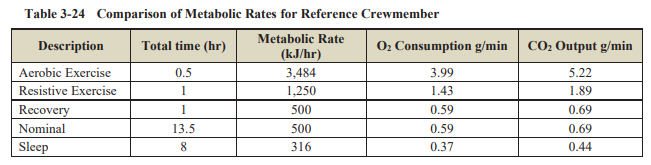
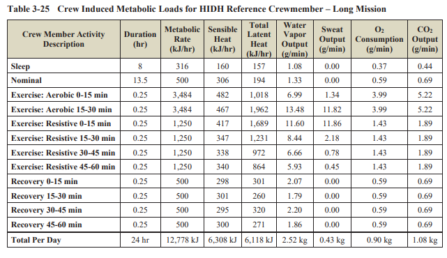
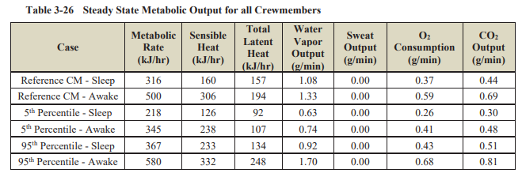
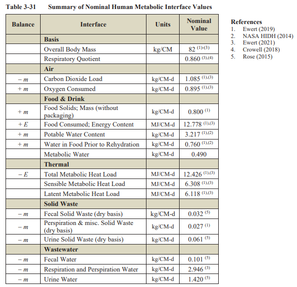
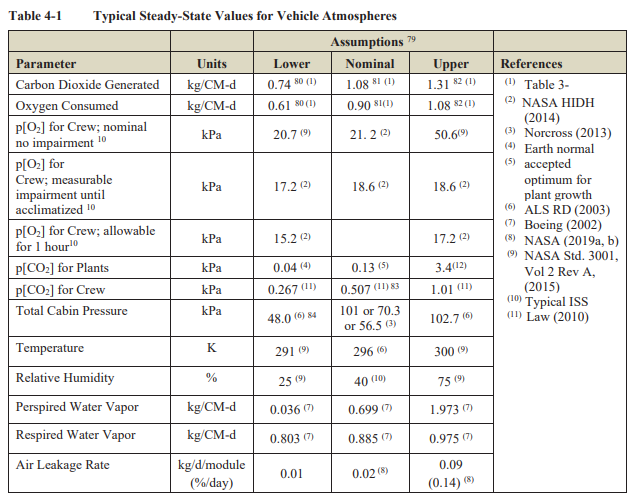
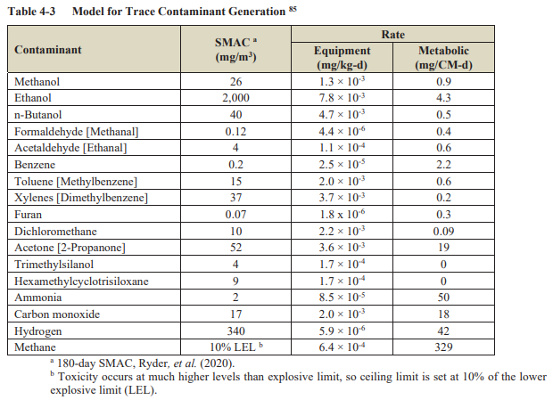
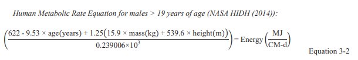
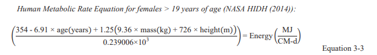
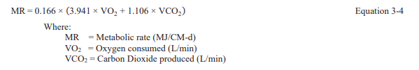

# ECLSS Sizing Tool

Python tool for computing Environmental Control and Life Support System (ECLSS) requirements for crewed spacecraft and habitat missions. All reference values trace to NASA/TP-2015-218570/REV2, *Life Support Baseline Values and Assumptions Document* (BVAD).

Given a crew (either a count or individualized profiles), cabin volume, and mission duration, the tool calculates oxygen generation rates, CO2 removal rates, thermal rejection loads, water balance, and consumables mass budgets for both open-loop and closed-loop life support architectures.

## Usage

```python
from eclss import Habitat, CrewMember

# Individualized crew with BMR-scaled metabolic rates
crew = [
    CrewMember("Captain Kirk",   age=34, mass_kg=82, height_m=1.78, sex="male"),
    CrewMember("Lt. Uhura",      age=29, mass_kg=61, height_m=1.68, sex="female"),
    CrewMember("Sci. Spock",     age=35, mass_kg=77, height_m=1.91, sex="male"),
    CrewMember("Eng. Scotty",    age=44, mass_kg=85, height_m=1.75, sex="male"),
]

hab = Habitat(
    crew=crew,
    cabin_volume_m3=25.0,
    mission_duration_days=180,
    loop_mode="closed",
)
result = hab.calculate()
print(result)
```

Anonymous crew (uses BVAD 82 kg reference crewmember):

```python
hab = Habitat(crew_count=4, cabin_volume_m3=25.0, mission_duration_days=180)
result = hab.calculate()
```

## BVAD Reference Data

All values below are from NASA/TP-2015-218570/REV2 (BVAD). The original tables are included for traceability.

### Daily Mass Balance (Figure 3-4)

Complete metabolic input/output balance for an 82 kg reference crewmember.


### Crew Metabolic Loads - Short Mission (Table 3-23)


### Activity-Level Metabolic Rates (Table 3-24)

Per-activity O2 consumption, CO2 production, and metabolic rates used for schedule-based simulation.



### Crew Metabolic Loads - Long Mission (Table 3-25)



### Steady-State Metabolic Output by Body Size (Table 3-26)

Shows how metabolic output varies across 5th, 50th, and 95th percentile crewmembers. Used to validate the BMR scaling approach.



### ISS Crew Schedule (Table 3-28)

Time allocation for weekday and weekend crew schedules in a weightless environment.


### Crew Metabolic Interface (Table 3-31)

Summary of nominal human metabolic interface values used as default constants.



### Vehicle Atmosphere (Table 4-1)

Safe ranges for cabin atmosphere parameters (pressure, O2, CO2, temperature, humidity).



### Trace Contaminant Generation (Table 4-3)

Trace contaminant generation model for future TCCS sizing.



### BMR Equations (Eq 3-2, 3-3, 3-4)

Basal metabolic rate equations used for individualized crew scaling.







## Scope

**Included:**
- Crew metabolic loads (O2, CO2, heat, water, food, waste)
- Individualized crew profiles with BMR scaling (Eq 3-2/3-3)
- Activity schedules (Table 3-24 reference, ISS weekday/weekend from Table 3-28)
- Atmosphere requirements (O2 generation, CO2 removal, leakage makeup)
- Thermal rejection loads (crew metabolic + equipment heat)
- Water balance (open-loop resupply, closed-loop recovery efficiency)
- Consumables mass budget (mission totals)
- Closed-loop O2 recovery via Sabatier + electrolysis

**Not yet included:**
- Time-series simulation engine
- ECLSS hardware rate limits
- Trace contaminant estimation
- Multi-module habitats
- EVA consumables
- Visualization with safe-range bands

## Citation

> NASA/TP-2015-218570/REV2. *Life Support Baseline Values and Assumptions Document.* National Aeronautics and Space Administration, 2015.
